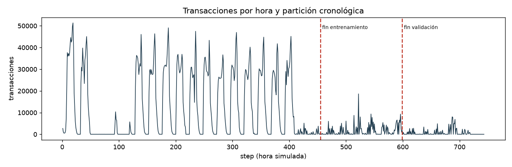
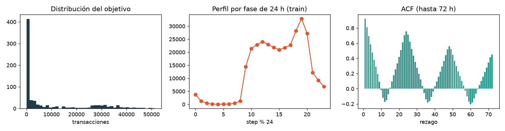
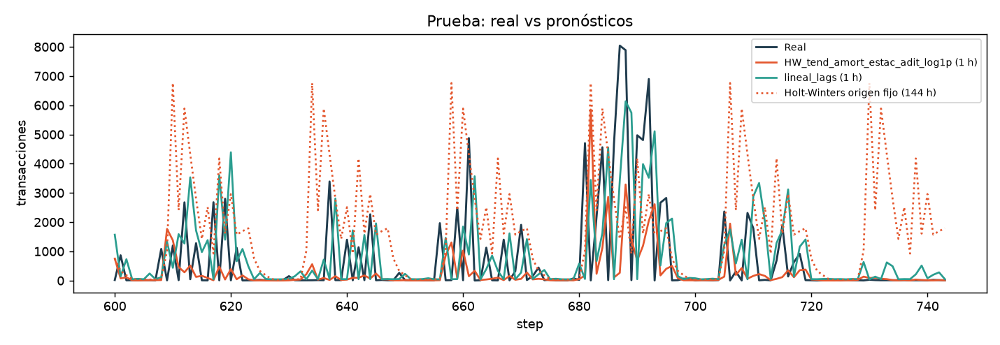
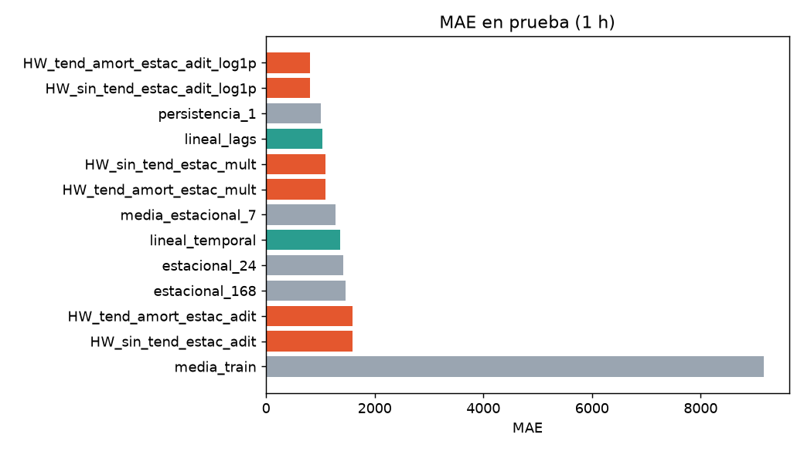
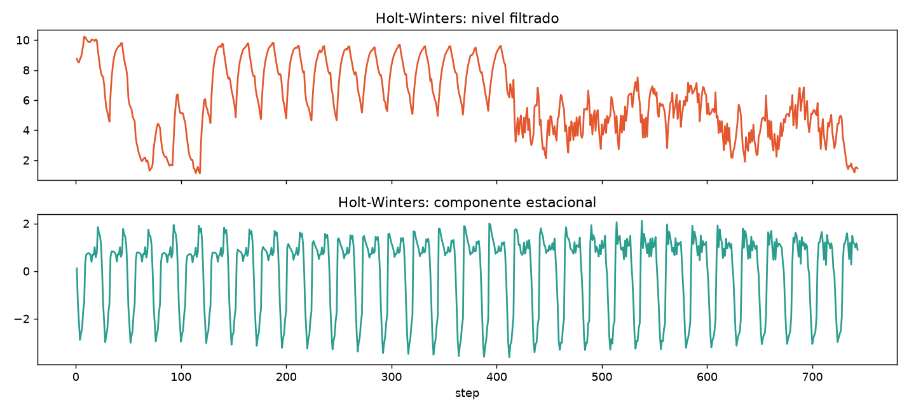
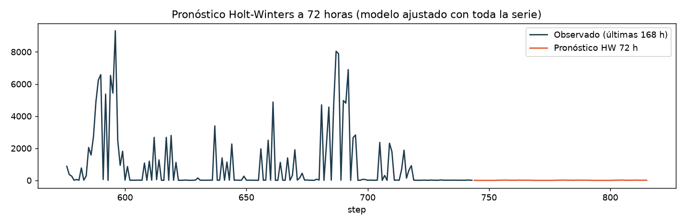

# Laboratorio 3 · Pronóstico del volumen horario de transacciones con regresión lineal y Holt-Winters

**Estadística para Analítica de Datos · UPTC · 2026-II · Profesor Duván Cataño**  
**Equipo:** David Nuncira, Juan Valderrama y Daniel Carrillo

> Resumen. Se continúa el PaySim adaptado de los Laboratorios 1 y 2. La unidad de análisis pasa de la transacción a la hora simulada y la variable objetivo es `transacciones_hora`. Se construyen pipelines de regresión lineal (rezagos y variables temporales), cinco baselines y el modelo **Holt-Winters** (suavizamiento exponencial triple, periodo 24 h) y se evalúan con partición cronológica y métricas MAE, RMSE, MAPE y R². Se entrega además un dashboard interactivo en Streamlit.

## 1. Introducción y objetivo

El Laboratorio 2 mostró una serie horaria de 743 observaciones (6.362.620 transacciones) con autocorrelación alta (ACF(1) = 0,9235; ACF(24) = 0,7546) y un perfil intradiario marcado. **Objetivo:** pronosticar el conteo de transacciones de las próximas horas. Como la variable es un conteo (cuantitativa discreta) se usa la rama de **regresión** de la guía; la regresión logística no aplica porque el dataset adaptado no incluye una etiqueta de clase. Por la fuerte estacionalidad se incorpora Holt-Winters, exigido para la sección de pronósticos.

## 2. Descripción de variables

| Variable | Tipo | Descripción |
|---|---|---|
| `step` | discreta | hora simulada (1 a N) |
| `transacciones_hora` | conteo (objetivo) | número de transacciones en la hora |
| `monto_total`, `monto_promedio`, `monto_mediano` | continuas | agregados de `monto` de la misma hora (no se usan como predictores: se conocen al cierre de la hora → fuga) |
| `fase_24` | discreta | `step % 24`, posición dentro del ciclo diario simulado |
| `lag_1`, `lag_24` | conteo | objetivo 1 y 24 horas antes (disponibles al pronosticar) |
| `step`, `sin/cos(2πt/24)`, `sin/cos(2πt/12)` | deterministas | tendencia y armónicos conocidos de antemano |

No se asigna día de semana ni fecha civil: el dataset es simulado y no hay evidencia de calendario real.

## 3. Limpieza y preprocesamiento

La serie se lee igual que en el Laboratorio 2 (`results/hourly_series.csv`). Se validan finitud, valores no negativos, unicidad y continuidad de `step`. No se imputan horas ni se eliminan picos por IQR (son actividad válida). Para la regresión se pierden las primeras 24 horas por falta de `lag_24`. Partición cronológica 60/20/20 sobre las filas supervisadas, fijada antes de comparar modelos; Holt-Winters usa además las horas 1–24 dentro de entrenamiento.

| grupo | n | inicio | fin |
|---|---|---|---|
| train (HW usa 1-455) | 431 | 25 | 455 |
| validacion | 144 | 456 | 599 |
| test | 144 | 600 | 743 |

## 4. Análisis exploratorio (EDA)

| n | media | mediana | std | min | max | asimetria | curtosis_exceso | cv_pct | total |
|---|---|---|---|---|---|---|---|---|---|
| 743 | 8.563,42 | 529 | 13.388,69 | 2 | 51.352 | 1,39 | 0,46 | 156,35 | 6.362.620 |

La distribución es muy asimétrica (asimetría 1,39; CV 156,35 %) y la serie cambia de régimen entre bloques de 168 horas:

| inicio | fin | media | mediana | std | max |
|---|---|---|---|---|---|
| 1 | 168 | 11.489,2 | 481 | 15.906,1 | 51.352 |
| 169 | 336 | 16.991,6 | 15.575 | 14.897,8 | 49.083 |
| 337 | 504 | 7.614,6 | 460,5 | 12.498,0 | 45.155 |
| 505 | 672 | 1.381,8 | 27 | 2.475,8 | 18.631 |
| 673 | 743 | 935,9 | 14 | 1.944,1 | 8.040 |





El perfil por fase muestra el ciclo diario que justifica un periodo estacional de 24 y la ACF decae lentamente. El cambio de nivel entre bloques implica que un ajuste global puede extrapolar mal; las gráficas describen asociación, no causalidad.

## 5. Pruebas de hipótesis e interpretación

Con α = 0,05 y solo datos de entrenamiento. H1 y H2 usan OLS con covarianza HAC/Newey-West (24 rezagos) y contraste de Wald; H3 es Kruskal-Wallis entre las 24 fases del ciclo (sin supuesto de normalidad). Se aplica corrección de Holm a las tres hipótesis.

| hipotesis | estadistico | gl | p | p_Holm | rechaza_H0_alpha_005 |
|---|---|---|---|---|---|
| H1: lag_1 y lag_24 = 0 (Wald HAC) | 1.507,5020 | 2 | < 0,0001 | < 0,0001 | Sí |
| H2: variables temporales = 0 (Wald HAC) | 75,0882 | 5 | < 0,0001 | < 0,0001 | Sí |
| H3: misma distribución en las 24 fases (Kruskal-Wallis) | 208,1097 | 23 | < 0,0001 | < 0,0001 | Sí |

- **H1: lag_1 y lag_24 = 0 (Wald HAC)**: estadístico 1.507,50 (gl=2), p ajustado por Holm < 0,0001 → se rechaza H0 con α = 0,05.
- **H2: variables temporales = 0 (Wald HAC)**: estadístico 75,09 (gl=5), p ajustado por Holm < 0,0001 → se rechaza H0 con α = 0,05.
- **H3: misma distribución en las 24 fases (Kruskal-Wallis)**: estadístico 208,11 (gl=23), p ajustado por Holm < 0,0001 → se rechaza H0 con α = 0,05.
- Diagnóstico de residuos de HW_tend_amort_estac_adit_log1p (Ljung-Box, 24 rezagos, entrenamiento): Q = 352,07, p < 0,0001. Persiste autocorrelación en los residuos: el modelo no captura toda la dependencia.

La significación dentro de entrenamiento no garantiza mejor pronóstico futuro; los p-valores son nominales por la dependencia temporal. Coeficientes con IC95 % HAC:

| variable | coef | ee_HAC | IC95_inf | IC95_sup | p_normal |
|---|---|---|---|---|---|
| const | 98,0812 | 1.284,3454 | -2.419,2357 | 2.615,3982 | 0,9391 |
| lag_1 | 0,7824 | 0,0792 | 0,6272 | 0,9377 | < 0,0001 |
| lag_24 | 0,1987 | 0,0814 | 0,0391 | 0,3584 | 0,0147 |
| step | -0,5500 | 3,7225 | -7,8461 | 6,7461 | 0,8825 |
| sin24 | 1.207,7950 | 573,0687 | 84,5804 | 2.331,0097 | 0,0351 |
| cos24 | -2.511,2485 | 585,8258 | -3.659,4671 | -1.363,0299 | < 0,0001 |
| sin12 | -259,2987 | 262,2905 | -773,3881 | 254,7906 | 0,3229 |
| cos12 | -826,5388 | 227,9968 | -1.273,4125 | -379,6650 | 0,0003 |

## 6. Construcción de pipelines

**Regresión lineal:** selección explícita de columnas → `StandardScaler` (ajustado solo con entrenamiento) → `LinearRegression`. Modelo A (`lineal_lags`): `lag_1`, `lag_24`. Modelo B (`lineal_temporal`): A + tendencia y armónicos. Regla fija de salida: `max(0, ŷ)`.

**Holt-Winters** (implementación propia, `src/holtwinters.py`, verificada contra la serie sin fuga de información). Con periodo m = 24:

```
ŷ(t|t-1) = l(t-1) + φ·b(t-1) + s(t-m)                         (estacionalidad aditiva)
l(t) = α·(y(t) - s(t-m)) + (1-α)·(l(t-1) + φ·b(t-1))
b(t) = β·(l(t) - l(t-1)) + (1-β)·φ·b(t-1)
s(t) = γ·(y(t) - l(t-1) - φ·b(t-1)) + (1-γ)·s(t-m)
```

En la variante multiplicativa, `ŷ = (l + φb)·s` y las actualizaciones usan cocientes. Los parámetros α, β, γ (y φ si la tendencia es amortiguada) se estiman minimizando la suma de cuadrados de los errores de un paso en entrenamiento; los estados iniciales salen de los primeros ciclos de entrenamiento. Se compara una rejilla fija de candidatos: sin tendencia / tendencia amortiguada × estacionalidad aditiva / multiplicativa, y las dos formas aditivas sobre `log(1+y)` (con retrotransformación y recorte a cero). α cercano a 1 haría que el nivel siga casi solo la última observación; γ controla la rapidez con que se actualiza el perfil de 24 h.

## 7. Entrenamiento de modelos

Se usa validación cruzada temporal expansiva (3 bloques de 72 h dentro de entrenamiento) solo para describir estabilidad. Después se compara en validación (candidatos entrenados únicamente con *train*), se elige por MAE sin mirar *test* y, antes de la prueba final, se reajustan con *train+validación*.

**Validación (1 hora):**

| modelo | familia | MAE | RMSE | MAPE_pct | WAPE_pct | R2 |
|---|---|---|---|---|---|---|
| estacional_24 | baseline | 1.780,71 | 3.162,23 | 2.584,50 | 107,14 | -0,40 |
| lineal_lags | regresion_lineal | 1.938,37 | 3.234,98 | 5.552,02 | 116,63 | -0,47 |
| HW_tend_amort_estac_adit_log1p | holt_winters | 2.002,17 | 4.596,05 | 2.570,82 | 120,47 | -1,97 |
| HW_sin_tend_estac_adit_log1p | holt_winters | 2.003,91 | 4.612,46 | 2.570,19 | 120,57 | -1,99 |
| persistencia_1 | baseline | 2.219,25 | 3.674,35 | 7.035,04 | 133,53 | -0,90 |
| lineal_temporal | regresion_lineal | 2.304,44 | 3.420,25 | 9.532,11 | 138,65 | -0,64 |
| HW_tend_amort_estac_mult | holt_winters | 2.359,59 | 3.846,56 | 7.383,41 | 141,97 | -1,08 |
| HW_sin_tend_estac_mult | holt_winters | 2.359,69 | 3.846,93 | 7.386,64 | 141,98 | -1,08 |
| HW_tend_amort_estac_adit | holt_winters | 2.789,01 | 4.383,78 | 10.748,86 | 167,81 | -1,70 |
| HW_sin_tend_estac_adit | holt_winters | 2.789,11 | 4.383,85 | 10.750,18 | 167,81 | -1,70 |
| media_estacional_7 | baseline | 5.589,32 | 8.972,69 | 25.300,67 | 336,30 | -10,31 |
| media_train | baseline | 11.055,70 | 11.292,09 | 56.493,66 | 665,20 | -16,92 |
| estacional_168 | baseline | 13.201,28 | 19.002,17 | 52.089,24 | 794,29 | -49,73 |

**Rejilla Holt-Winters en validación:**

| modelo | MAE | RMSE | R2 | origen_fijo_MAE | param_alpha | param_gamma | param_beta | param_phi |
|---|---|---|---|---|---|---|---|---|
| HW_tend_amort_estac_adit_log1p | 2.002,1661 | 4.596,0488 | -1,9679 | 1.595,1104 | 0,6408 | 0,0894 | 0,0001 | 0,8000 |
| HW_sin_tend_estac_adit_log1p | 2.003,9143 | 4.612,4551 | -1,9891 | 1.595,0011 | 0,6403 | 0,0897 | nan | nan |
| HW_tend_amort_estac_mult | 2.359,5928 | 3.846,5602 | -1,0788 | 1.614,5501 | 0,9999 | 0,0001 | 0,0001 | 0,8000 |
| HW_sin_tend_estac_mult | 2.359,6920 | 3.846,9253 | -1,0792 | 1.614,4749 | 0,9999 | 0,0001 | nan | nan |
| HW_tend_amort_estac_adit | 2.789,0076 | 4.383,7760 | -1,7001 | 6.703,2326 | 0,9999 | 0,0627 | 0,0001 | 0,8000 |
| HW_sin_tend_estac_adit | 2.789,1082 | 4.383,8550 | -1,7002 | 6.701,2609 | 0,9999 | 0,0627 | nan | nan |

**Validación cruzada expansiva (promedio de 3 bloques):**

| modelo | MAE | RMSE | R2 |
|---|---|---|---|
| HW_tend_amort_estac_adit_log1p | 15.036,05 | 92.938,86 | -158,63 |
| lineal_lags | 3.329,07 | 5.392,64 | 0,84 |
| lineal_temporal | 3.635,64 | 5.166,71 | 0,85 |
| persistencia_1 | 3.501,50 | 6.101,79 | 0,80 |

Selección: regresión lineal → `lineal_lags`; Holt-Winters → `HW_tend_amort_estac_adit_log1p`; baseline → `estacional_24`.

## 8. Evaluación del modelo

Protocolo principal: pronóstico de **una hora** sobre el bloque de prueba; el estado de Holt-Winters y los rezagos incorporan lo observado hasta *t−1*, pero los parámetros no se reestiman. MAPE se calcula solo con y ≠ 0; WAPE complementa a MAPE cuando hay conteos pequeños.

| modelo | familia | MAE | RMSE | MAPE_pct | WAPE_pct | R2 |
|---|---|---|---|---|---|---|
| HW_tend_amort_estac_adit_log1p | holt_winters | 811,43 | 1.601,91 | 2.730,46 | 112,80 | -0,08 |
| HW_sin_tend_estac_adit_log1p | holt_winters | 811,45 | 1.601,74 | 2.729,57 | 112,80 | -0,08 |
| persistencia_1 | baseline | 1.003,33 | 1.800,72 | 7.288,21 | 139,47 | -0,37 |
| lineal_lags | regresion_lineal | 1.040,06 | 1.702,59 | 7.379,64 | 144,58 | -0,22 |
| HW_sin_tend_estac_mult | holt_winters | 1.096,97 | 2.046,35 | 8.228,53 | 152,49 | -0,77 |
| HW_tend_amort_estac_mult | holt_winters | 1.097,79 | 2.048,57 | 8.233,90 | 152,60 | -0,77 |
| media_estacional_7 | baseline | 1.282,36 | 1.857,60 | 9.711,53 | 178,26 | -0,45 |
| lineal_temporal | regresion_lineal | 1.365,84 | 1.946,83 | 11.348,92 | 189,86 | -0,60 |
| estacional_24 | baseline | 1.421,38 | 2.505,30 | 7.401,16 | 197,58 | -1,65 |
| estacional_168 | baseline | 1.464,31 | 2.694,99 | 9.246,21 | 203,55 | -2,06 |
| HW_tend_amort_estac_adit | holt_winters | 1.594,64 | 2.856,01 | 13.742,10 | 221,67 | -2,44 |
| HW_sin_tend_estac_adit | holt_winters | 1.594,68 | 2.856,05 | 13.742,75 | 221,67 | -2,44 |
| media_train | baseline | 9.167,18 | 9.295,64 | 77.354,41 | 1.274,31 | -35,43 |

**Origen fijo (horizonte completo del bloque de prueba, sin observar datos nuevos):**

| modelo | familia | MAE | RMSE | MAPE_pct | WAPE_pct | R2 |
|---|---|---|---|---|---|---|
| HW_tend_amort_estac_mult | holt_winters | 1.177,97 | 1.740,43 | 7.323,31 | 163,75 | -0,28 |
| HW_sin_tend_estac_mult | holt_winters | 1.178,32 | 1.741,32 | 7.324,20 | 163,80 | -0,28 |
| HW_tend_amort_estac_adit_log1p | holt_winters | 1.595,98 | 2.414,34 | 13.209,48 | 221,85 | -1,46 |
| HW_sin_tend_estac_adit_log1p | holt_winters | 1.600,26 | 2.420,73 | 13.245,83 | 222,45 | -1,47 |
| lineal_lags | regresion_lineal | 1.963,35 | 2.242,74 | 15.837,44 | 272,92 | -1,12 |
| estacional_24 | baseline | 2.047,74 | 3.164,17 | 16.365,70 | 284,65 | -3,22 |
| lineal_temporal | regresion_lineal | 5.998,88 | 7.956,24 | 48.183,86 | 833,89 | -25,69 |
| HW_sin_tend_estac_adit | holt_winters | 7.523,23 | 10.225,99 | 56.391,21 | 1.045,79 | -43,09 |
| HW_tend_amort_estac_adit | holt_winters | 7.525,22 | 10.228,34 | 56.406,14 | 1.046,07 | -43,11 |

**Diagnóstico complementario en prueba (1 h): sesgo medio = real − pronóstico y correlación con lo real:**

| modelo | pronostico_medio | sesgo_medio | correlacion |
|---|---|---|---|
| HW_tend_amort_estac_adit_log1p | 292,688 | 426,694 | 0,226 |
| HW_sin_tend_estac_adit_log1p | 293,100 | 426,282 | 0,226 |
| persistencia_1 | 731,938 | -12,556 | 0,317 |
| lineal_lags | 846,881 | -127,499 | 0,284 |
| HW_sin_tend_estac_mult | 815,406 | -96,025 | 0,280 |
| HW_tend_amort_estac_mult | 815,843 | -96,461 | 0,280 |
| media_estacional_7 | 1.396,608 | -677,226 | 0,271 |
| lineal_temporal | 1.319,723 | -600,341 | 0,246 |
| estacional_24 | 1.125,146 | -405,764 | 0,018 |
| estacional_168 | 1.332,674 | -613,292 | 0,203 |
| HW_tend_amort_estac_adit | 1.571,680 | -852,298 | 0,229 |
| HW_sin_tend_estac_adit | 1.571,797 | -852,415 | 0,229 |





- En validación, el candidato Holt-Winters con menor MAE fue **HW_tend_amort_estac_adit_log1p** (MAE 2.002,17), y la regresión lineal seleccionada fue **lineal_lags** (MAE 1.938,37). La selección usó solo validación.
- En prueba (pronóstico de 1 hora con parámetros congelados) **HW_tend_amort_estac_adit_log1p** obtuvo MAE 811,43, RMSE 1.601,91, MAPE 2.730,46 % y R² -0,0819; **lineal_lags** obtuvo MAE 1.040,06 y R² -0,2222. Holt-Winters mejora a la regresión lineal en MAE y supera a la persistencia de 1 h (MAE 1.003,33); el baseline estacional de 24 h tuvo MAE 1.421,38.
- El mejor modelo por MAE en prueba, solo a modo descriptivo, fue **HW_tend_amort_estac_adit_log1p** (MAE 811,43); Holt-Winters quedó en la posición 1 de 13.
- Con origen fijo (144 h hacia adelante sin observar datos nuevos) el MAE de Holt-Winters fue 1.595,98 y el de la regresión lineal recursiva 1.963,35. Es una tarea más difícil que la de una hora; sus métricas no deben mezclarse.
- Un R² negativo indica un error cuadrático mayor que el de predecir con la media real del bloque de prueba; esa media no se conoce al pronosticar, así que el valor debe leerse como señal de dificultad (cambio de nivel, muchos conteos pequeños), no como un fallo del cálculo.
- **Selección en validación:** el mejor modelo global fue **estacional_24** (MAE 1.780,71); HW_tend_amort_estac_adit_log1p fue el mejor de su familia pero ocupó la posición 3 de 13 (MAE 2.002,17). Su resultado en prueba no se anticipaba en validación, así que no debe leerse como superioridad demostrada.
- **Referencia trivial:** pronosticar siempre 0 daría MAE 719,38 en prueba (la media del bloque; la mediana es 14,00), menor que el del mejor modelo (HW_tend_amort_estac_adit_log1p, 811,43). Ningún modelo supera esa referencia en MAE: con conteos concentrados cerca de cero el MAE premia a los pronósticos bajos. Por eso se reportan también R², el sesgo y la correlación con lo real.
- **Inestabilidad en validación cruzada:** HW_tend_amort_estac_adit_log1p tuvo MAE medio 15.036 (peor bloque 33.403) frente a 3.329 de lineal_lags. Las variantes sobre log(1+y) se retrotransforman con expm1, que amplifica de forma exponencial los errores tras un cambio de régimen; las variantes sin transformación (p. ej. multiplicativa) no mostraron ese problema. La ventaja en un único bloque de prueba no es evidencia suficiente para uso operativo.



**Pronóstico a 72 horas** con el modelo Holt-Winters seleccionado, ajustado con toda la serie:



## 9. Conclusiones

- En validación, el candidato Holt-Winters con menor MAE fue **HW_tend_amort_estac_adit_log1p** (MAE 2.002,17), y la regresión lineal seleccionada fue **lineal_lags** (MAE 1.938,37). La selección usó solo validación.
- En prueba (pronóstico de 1 hora con parámetros congelados) **HW_tend_amort_estac_adit_log1p** obtuvo MAE 811,43, RMSE 1.601,91, MAPE 2.730,46 % y R² -0,0819; **lineal_lags** obtuvo MAE 1.040,06 y R² -0,2222. Holt-Winters mejora a la regresión lineal en MAE y supera a la persistencia de 1 h (MAE 1.003,33); el baseline estacional de 24 h tuvo MAE 1.421,38.
- El mejor modelo por MAE en prueba, solo a modo descriptivo, fue **HW_tend_amort_estac_adit_log1p** (MAE 811,43); Holt-Winters quedó en la posición 1 de 13.
- **Selección en validación:** el mejor modelo global fue **estacional_24** (MAE 1.780,71); HW_tend_amort_estac_adit_log1p fue el mejor de su familia pero ocupó la posición 3 de 13 (MAE 2.002,17). Su resultado en prueba no se anticipaba en validación, así que no debe leerse como superioridad demostrada.
- **Referencia trivial:** pronosticar siempre 0 daría MAE 719,38 en prueba (la media del bloque; la mediana es 14,00), menor que el del mejor modelo (HW_tend_amort_estac_adit_log1p, 811,43). Ningún modelo supera esa referencia en MAE: con conteos concentrados cerca de cero el MAE premia a los pronósticos bajos. Por eso se reportan también R², el sesgo y la correlación con lo real.
- **Inestabilidad en validación cruzada:** HW_tend_amort_estac_adit_log1p tuvo MAE medio 15.036 (peor bloque 33.403) frente a 3.329 de lineal_lags. Las variantes sobre log(1+y) se retrotransforman con expm1, que amplifica de forma exponencial los errores tras un cambio de régimen; las variantes sin transformación (p. ej. multiplicativa) no mostraron ese problema. La ventaja en un único bloque de prueba no es evidencia suficiente para uso operativo.
- Los resultados son pronósticos puntuales; no se publican intervalos porque no se validó su cobertura.
- Limitaciones: serie simulada y corta (pocos ciclos de 24 h), cambio de nivel entre bloques, muchos conteos pequeños que inflan MAPE y un único bloque de prueba (la comparación entre modelos con diferencias pequeñas no es concluyente).
- Trabajo futuro: ventanas móviles con reestimación, detección de cambios de régimen, modelos de conteo y SARIMA como contraste.

## Apéndice · Reproducibilidad

```
python -m pip install -r requirements.txt
python scripts/run_analysis.py
python scripts/verify.py
python scripts/build_report.py
python -m streamlit run app.py
```
